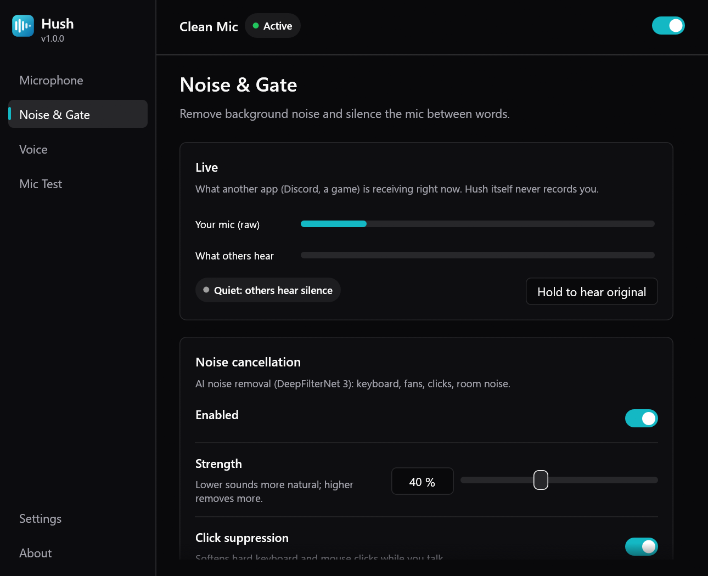
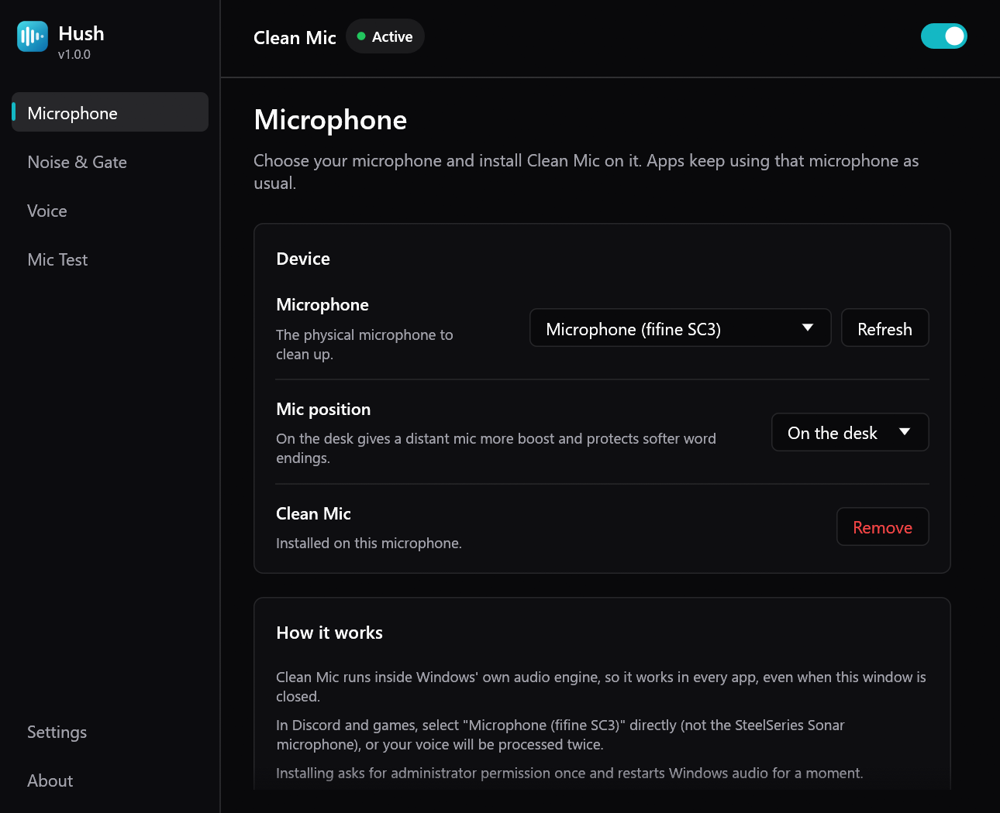
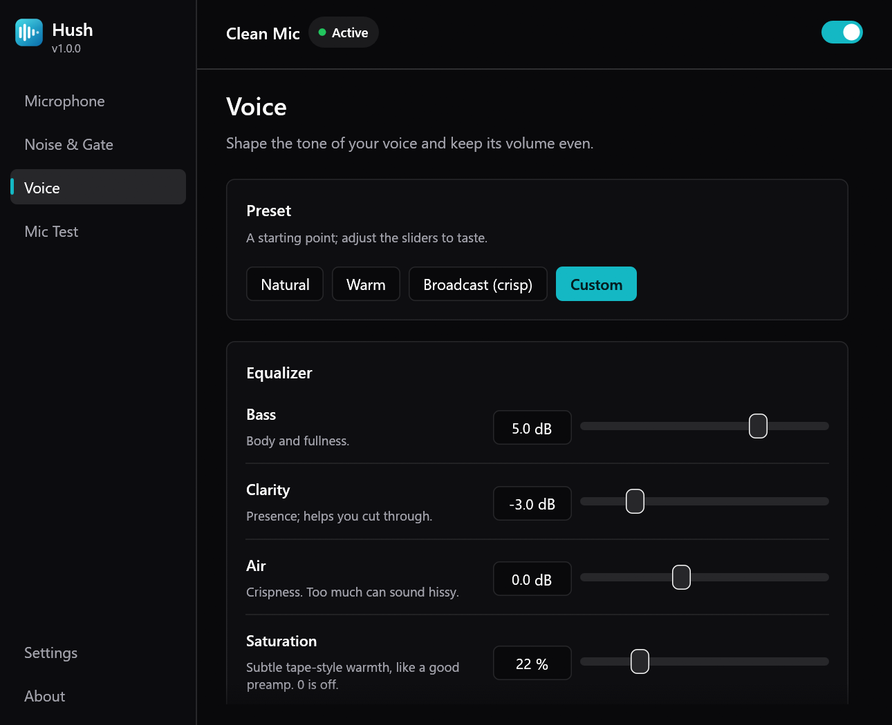
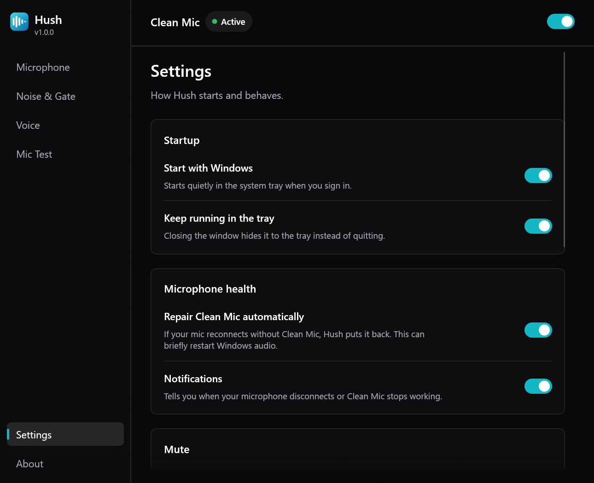

<p align="center">
  
</p>

<h1 align="center">Hush</h1>

<p align="center">
  <b>Clean up your real microphone in every app. No virtual mic, no cloud, no fuss.</b>
</p>

<p align="center">
  <a href="../../releases/latest"><b>Download for Windows</b></a> ·
  <a href="#what-it-does">Features</a> ·
  <a href="#tested-properly">Testing</a> ·
  <a href="docs/technical.md">Technical details</a>
</p>

<p align="center">
  
  
  
  
</p>

<p align="center">
  
</p>

---

Your microphone hears everything: the fan, the keyboard, the mouse, the room.
**Hush removes it before any app gets the audio.** It runs inside Windows'
own audio engine, on the microphone you already use. Discord, games, OBS,
Teams and your browser keep their settings and just get a cleaner voice.

There's nothing to switch to and nothing to route. You don't create an
account and nothing goes to a server. Hush sits in your tray and keeps
your mic clean.

## Why Hush

**It works in every app, automatically.**
Most noise removers make you pick a virtual microphone in each app. Hush
cleans the real one, so every app gets the result. It processes once,
however many apps are listening.

**Everything runs on your PC.**
Noise removal uses DeepFilterNet 3, an open-source neural model, on your
CPU. No GPU is needed. Your voice never leaves your PC, and Hush makes no
network calls unless you click **Check for updates**.

**It's light.**
It uses about 3% of one CPU core. There's no driver, so it works with Secure
Boot on. Close the window and Hush keeps working from the tray in about 3 MB
of memory.

**It keeps itself working.**
If you unplug and replug your mic and Windows drops Clean Mic, Hush notices
and puts it back on its own, then tells you it did.

## What it does

| | |
| --- | --- |
| **Background noise removed** | Fans, keyboards, traffic and room hum are taken out by a neural model built for speech. |
| **Silence between words** | A voice gate fades your mic out when you stop talking. A single key click doesn't open it, and your first syllable isn't cut off. |
| **Clicks tamed while you talk** | Sharp keyboard and mouse clicks under your voice are ducked. |
| **An even, steady voice** | Auto level and a vocal compressor keep you at a comfortable volume whether you lean in or sit back. |
| **Voice that sounds like you, only better** | Natural, Warm and Broadcast presets, plus Bass, Clarity and Air, a de-esser and a pop filter. |
| **Desk-mic mode** | Tell Hush the mic sits on your desk, and it boosts more and protects softer word endings. |
| **Mic Test** | Hear yourself exactly as others do, hold a button to hear the original, and record a 10-second take. |
| **Mute hotkey** | Optional. One key mutes your mic in every app, and the tray shows the state. |
| **Level warnings** | Hush tells you when your mic is clipping or too quiet to clean well. |
| **Microphone health watch** | Notices a disconnected mic, or Clean Mic going missing after a replug, and repairs it without an administrator prompt. |
| **Your settings, portable** | Save and restore a snapshot of your tuning, or export and import it as a file. |

<table>
  <tr>
    <td></td>
    <td></td>
    <td></td>
  </tr>
  <tr>
    <td align="center">Pick your mic</td>
    <td align="center">Shape your voice</td>
    <td align="center">Set it and forget it</td>
  </tr>
</table>

## Get started

1. **Download** `Hush-Setup-<version>.exe` from [Releases](../../releases/latest).
2. **Run it** and accept the administrator prompt. Choose your microphone and
   whether it's near your mouth or on the desk.
3. **Done.** Windows audio restarts for a moment, then Hush opens. Use your
   microphone in any app as usual.

Then, in Discord and games, select your **physical microphone** (for example
`Microphone (fifine SC3)`), not another product's virtual mic. Turn off
Discord's own noise suppression so your voice isn't cleaned twice.

> [!NOTE]
> The installer isn't code-signed yet, so Windows SmartScreen may warn about
> an unrecognised app. Choose **More info → Run anyway** only if you
> downloaded it from this repository's Releases page.

**Check it's working:** start a call or press **Start test** on the Mic
Test page. The badge next to **Clean Mic** turns **Active**, and the Noise
& Gate page shows *Your mic (raw)* next to *What others hear*.

**Upgrading** is just running a newer installer. Your settings are kept.
**Uninstalling** is in Windows **Settings → Apps → Installed apps → Hush**.
That removes the plugin, the app and its settings.

## Tested properly

Hush wasn't thrown together. Every release went through the same process:

- **Judged by ear, backed by measurements.** Every change to the sound was
  compared level-matched against the version before it, and measured
  offline for speech dips, leftover noise and flutter. A change ships only if
  it sounds better. Several ideas that looked good on paper didn't make the
  cut, and their write-ups are in the repo.
- **Many approaches tried.** Several models and processing approaches were
  evaluated, including neural noise removal, speech detection, voice
  protection, click guards and dereverb. Only the combination that sounded
  best made it into Hush.
- **No accidental changes.** Unchanged settings must reproduce the previous
  release's sound byte for byte, so a code change can't quietly change how
  you sound.
- **94 automated tests** run on every push. Failure paths were tested by
  deliberately crashing them: if processing ever fails, your mic keeps
  working unprocessed instead of taking Windows audio down with it.
- **Used daily on real PCs** in Discord calls and games.

Read the full write-up in **[How Hush was tested](docs/testing.md)**. Running
it on a different mic or PC? [Tell us how it went](../../issues/new/choose).

## Good to know

- **Requirements:** Windows 10 or 11 (64-bit), administrator rights to
  install, and **Audio enhancements** turned on for your mic (**Settings →
  System → Sound → your mic**). Windows skips effect plugins when they're
  off.
- **Not a copy of NVIDIA Broadcast or SteelSeries Sonar,** and it doesn't
  claim to sound like them. It doesn't remove room echo or other people's
  voices yet.
- **Privacy:** Hush never records you. Mic Test records only when you press
  **Record**, and keeps the file on your PC. **Check for updates** is the
  only network call, and it runs only when you click it.

<details>
<summary><b>Troubleshooting</b></summary>

| Symptom | Try |
| --- | --- |
| Badge stays *Ready (mic idle)* during a call | The app is using a different microphone, or **Audio enhancements** are off for this one. |
| Hush says *Not processing* after you replug a USB mic | Hush repairs this by itself within a few seconds. If it doesn't, click **Fix now** on the Microphone page. |
| Hush says *Audio enhancements are off* | Windows skips every audio effect on that mic. Click **Sound settings**, open the microphone's properties and turn **Audio enhancements** on. |
| Hush says an app is recording without Clean Mic | That app is asking Windows for raw audio. Turn off its "exclusive" or "raw" mic mode. |
| Voice sounds processed twice or robotic | Turn off Discord's noise suppression, and Sonar ClearCast or NVIDIA Broadcast on the same mic. |
| Soft words get cut | Raise gate **Sensitivity**, or set **Mic position** to **On the desk**. |
| Noise still opens the gate | Lower **Sensitivity**. |
| Hush warns that your mic is clipping or too quiet | Change the mic's input level in Windows Sound settings. |
| Setup says another effect is already attached | Another product owns that mic's effect slot. Hush won't replace it, so remove the other product's mic effect first. |

</details>

## Found a problem?

[Open an issue](../../issues/new/choose) with your Windows version,
microphone model, the app you were using, and the output of **Copy
diagnostics** (Settings → Support).

> [!WARNING]
> Don't attach recordings of your voice to a public issue unless you're
> happy for anyone to hear them.

## Under the hood

Hush is written in Rust. It installs an audio processing object (APO) on
your microphone, which Windows' audio engine runs on every buffer before any
app sees it:

```text
mic → rumble filter → DeepFilterNet 3 + voice gate → click ducking → voice EQ
    → auto level → de-esser → limiter → every app
```

- [Technical details](docs/technical.md): requirements, cost, files,
  microphone repair, debugging and building from source.
- [Architecture](docs/architecture.md): the full signal chain and design
  decisions.
- [How Hush was tested](docs/testing.md): methods, evaluations and known
  gaps.
- [Changelog](CHANGELOG.md)

## License

MIT, see [LICENSE](LICENSE). Hush bundles DeepFilterNet 3 (MIT/Apache-2.0)
and RNNoise model weights (BSD-3-Clause), among other components. See
[THIRD-PARTY-NOTICES.txt](THIRD-PARTY-NOTICES.txt). Hush was called
SteelMixer before 0.4.0, and its installer migrates that older install.
